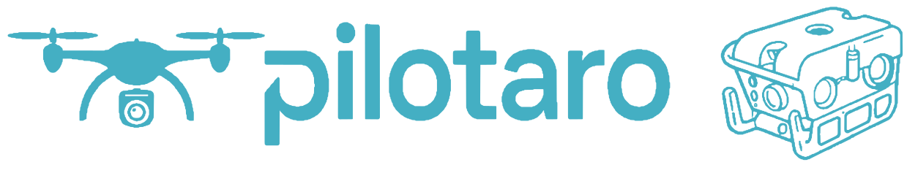

# 

[](https://github.com/juanscelyg/pilotaro/actions/workflows/rolling.yml)

Autopilot for multirotors and underwater vehicles on ROS 2. One process per robot runs a
real-time cycle (estimator → flight modes → controller → actuators) over a shared robot
state; the state estimator, the controller and the actuator output are pluginlib plugins
selected and configured with ROS 2 parameters. It is driven with `std_srvs/Trigger`
services, `offboard/*` setpoints and waypoint missions.

| Holybro X500 | Parrot Bebop 2 | BlueROV2 Heavy |
|:---:|:---:|:---:|
| [](docs/vehicles.md) | [](docs/vehicles.md) | [](docs/vehicles.md) |
| `sim.launch.py` — LOITER at 2.2 m | `model:=bebop2` — LOITER at 2.0 m | `robots:=rov:bluerov2_heavy` — holding depth at 2 m |

- **Vehicles**: Holybro **X500** and Parrot **Bebop 2** (multirotors) and Blue Robotics
  **BlueROV2 Heavy** (8 thrusters), described in URDF/xacro with their sensors; their
  parameters are generated from the URDF.
- **Simulation**: Gazebo (gz-sim), with an empty world and an underwater world with
  buoyancy and hydrodynamics (added mass, damping); one or several robots of any model.
- **Plugins**: state estimator, controller and actuator output, selected in the parameter
  files.
- **State estimation**: the odometry of an external source, or an INS EKF of its own (IMU,
  GNSS, barometer, magnetometer and optional external odometry).
- **Controllers**: geometric cascade controller for multirotors (any planar rotor layout)
  and 6-DOF controller with hydrodynamic feed-forward for vectored, reversible thrusters.
- **Flight modes**: takeoff (or dive), loiter, landing, offboard, waypoint missions and
  return to launch.
- **Failsafes and pre-arm checks**: battery, geofence and depth limit, navigation loss,
  ground station link, flip; configurable actions, changeable in flight.
- **Real time**: `SCHED_FIFO`, locked memory and, optionally, a dedicated core.
- **Multi-robot**: namespace, topics, frames and Gazebo model come from one `robot_name`.

## Quick start

```bash
cd ~/ros_ws   # your colcon workspace, with pilotaro cloned in src/
rosdep install -y --ignore-src --from-paths src
colcon build --packages-up-to pilotaro pilotaro_gazebo --cmake-args -DCMAKE_BUILD_TYPE=Release
source install/setup.bash
ros2 launch pilotaro_gazebo sim.launch.py     # Gazebo + x500 + pilotaro
```

```bash
ros2 service call /x500/arming  std_srvs/srv/Trigger
ros2 service call /x500/takeoff std_srvs/srv/Trigger     # climbs 2 m and holds (LOITER)
ros2 service call /x500/landing std_srvs/srv/Trigger     # lands and disarms
```

### More information

[Quick start, in detail](docs/quickstart.md): the other vehicles, offboard setpoints,
several robots in one simulation and the launch files.

## Documentation

| Page | Contents |
|---|---|
| [Quick start, in detail](docs/quickstart.md) | Build, the three vehicles in Gazebo, flying with services and setpoints, multi-robot, launch files. |
| [Packages](docs/packages.md) | Every package of the repository and what it holds. |
| [ROS 2 interfaces](docs/interfaces.md) | Services, topics, timeouts. |
| [Flight modes](docs/modes.md) | Modes and their transitions, waypoint missions, return to launch. |
| [Failsafes](docs/failsafes.md) | Failsafes, their actions and the pre-arm checks. |
| [Architecture and plugins](docs/architecture.md) | The cycle, the plugin interfaces, the actuator outputs, writing a plugin. |
| [State estimators](docs/estimators.md) | `OdometryEstimator` and the INS EKF `InsEkfEstimator`. |
| [Controllers](docs/controllers.md) | `CascadeController` (multirotors) and `UnderwaterController` (ROV, AUV). |
| [Parameters](docs/parameters.md) | Parameter files, their order and what each block configures. |
| [Real time](docs/realtime.md) | The real-time loop, its parameters and the system permissions. |
| [Vehicles](docs/vehicles.md) | X500, Bebop 2, BlueROV2 Heavy, the underwater world, parameters from the URDF, adding a vehicle. |
| [Testing and CI](docs/testing.md) | Unit tests, flight, mission and failsafe checks in Gazebo, continuous integration. |
| [Licenses](docs/licenses.md) | Third-party content and the sources of the physical parameters. |

## License

Apache 2.0 ([LICENSE](LICENSE)), Copyright 2026 Juan S. Cely G. The BlueROV2 Heavy meshes
come from [PX4-gazebo-models](https://github.com/PX4/PX4-gazebo-models) (BSD 3-Clause); the
X500 (CC-BY 4.0) and Bebop 2 (CC0) meshes are downloaded from Gazebo Fuel at run time. Details
in [Licenses](docs/licenses.md).
