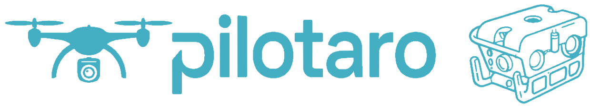
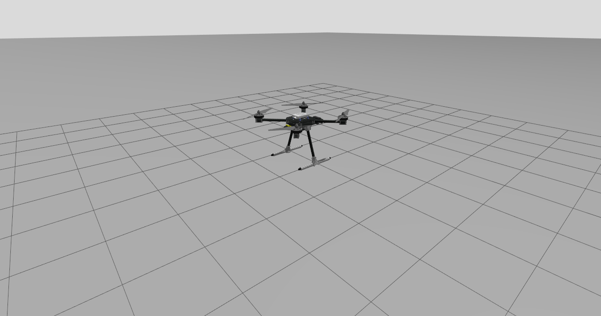
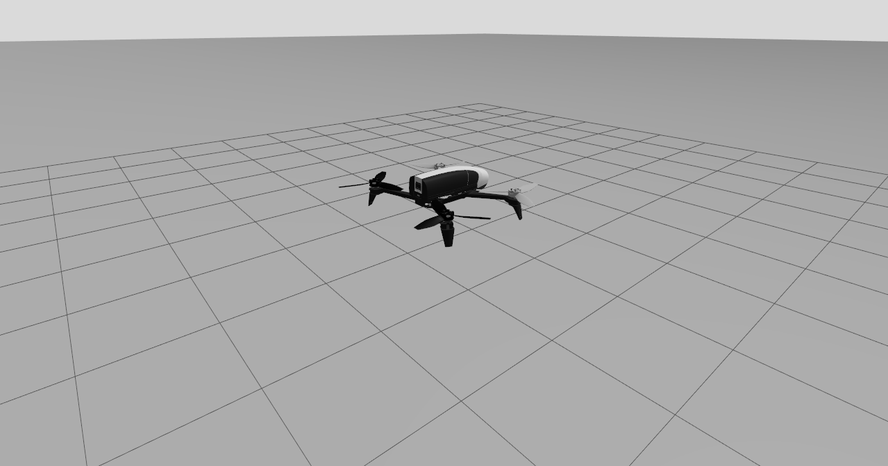
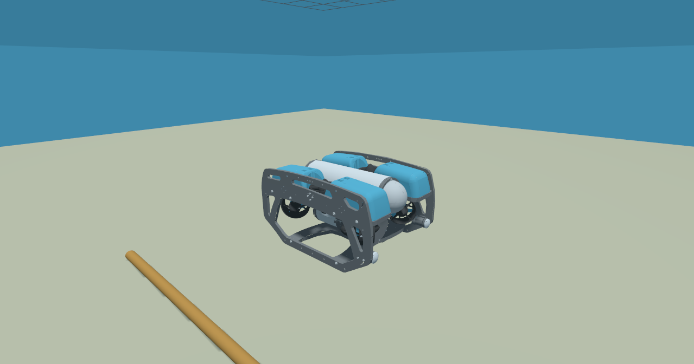

# 

Autopilot for multirotors and underwater vehicles on ROS 2 (Jazzy), successor of
[acks](../acks). It keeps its interface (`std_srvs/Trigger` services, `offboard/*` setpoints,
`mode` topic) and its flight modes, and adds:

- **State estimator, controller and actuator output as plugins** (pluginlib), selected and
  configured in the parameter files.
- **Real-time main loop**: `SCHED_FIFO`, locked memory and, optionally, a dedicated core.
- **Per-instance platform name** for multi-robot systems: namespace, topics, frames and
  Gazebo model all come from the same `robot_name`.
- **Vehicles described in URDF/xacro**: Holybro X500, Parrot Bebop 2 and BlueROV2, each with
  its sensors, plus a script that updates each vehicle's parameters from its URDF.
- **Underwater world** with buoyancy and hydrodynamics (added mass, damping).

| Holybro X500 | Parrot Bebop 2 | BlueROV2 |
|:---:|:---:|:---:|
|  |  |  |
| `sim.launch.py` — LOITER at 2.2 m after takeoff | `model:=bebop2` — LOITER at 2.0 m | `world:=underwater` — holding depth after a 2 m dive |

## Packages

| Package | Contents |
|---|---|
| `pilotaro` | Metapackage: `launch/pilotaro.launch.py` and `params/pilotaro.params.yaml`. |
| `pilotaro_common` | ROS-free types: `RobotState`, `VehicleState`, `ControlSetpoint`, `VehicleParams`, `FlightMode`. |
| `pilotaro_core` | Plugin interfaces: `StateEstimatorBase`, `ControllerBase`, `ActuatorOutputBase`, and parameter loading. |
| `pilotaro_estimators` | `EstimatorNode` (loads the plugin) and the `OdometryEstimator` plugin. |
| `pilotaro_controllers` | `ControllersNode` (loads the plugin) and the `CascadeController` (multirotors) and `UnderwaterController` (vectored thrusters) plugins. |
| `pilotaro_states` | `StatesNode`: flight modes, services, offboard setpoints. The logic lives in `FlightModeMachine` (ROS-free, with tests). |
| `pilotaro_actuators` | `ActuatorsNode` (per-mode policy, loads the plugin) and the `MotorSpeedOutput` and `ThrusterOutput` output plugins. |
| `pilotaro_system` | `PilotaroNode` (lifecycle) and `pilotaro_main`, the real-time loop. |
| `pilotaro_description` | Vehicles: `urdf/<vehicle>.urdf.xacro`, `config/<vehicle>.params.yaml`, `meshes/` (BlueROV2) and `scripts/update_vehicle_params.py`. |
| `pilotaro_gazebo` | Empty and underwater worlds, simulation launches (one or several vehicles of any model, disaster world) and `scripts/flight_check.py`. |

## Quick start

```bash
cd ~/ws/fleet_ws
colcon build --packages-up-to pilotaro pilotaro_gazebo
source install/setup.bash

# Gazebo (GUI) + x500 + pilotaro. headless:=true without GUI, cameras:=false without cameras
ros2 launch pilotaro_gazebo sim.launch.py

# The same with a Parrot Bebop 2
ros2 launch pilotaro_gazebo sim.launch.py model:=bebop2 robots:=bebop2

# A BlueROV2 in the underwater world (floats at the surface until armed)
ros2 launch pilotaro_gazebo sim.launch.py world:=underwater robots:=rov:bluerov2
```

In another terminal (the namespace is the robot name, `x500` by default):

```bash
ros2 service call /x500/arming  std_srvs/srv/Trigger
ros2 service call /x500/takeoff std_srvs/srv/Trigger     # climbs 2 m and switches to LOITER

# offboard: first publish setpoints (>= 2 Hz), then request the mode
ros2 topic pub -r 10 /x500/offboard/pose geometry_msgs/msg/PoseStamped \
  "{header: {frame_id: odom}, pose: {position: {x: 3.0, y: 2.0, z: 3.0}, orientation: {w: 1.0}}}"
ros2 service call /x500/offboard std_srvs/srv/Trigger

ros2 service call /x500/landing std_srvs/srv/Trigger     # lands and disarms
ros2 topic echo /x500/mode
```

Modes, services and acceptance conditions are the same as in acks (see its README).
`offboard` is accepted in any mode except DISARMED, as in acks.

| Launch | What it does |
|---|---|
| `pilotaro pilotaro.launch.py` | pilotaro only (`robot_name`, `vehicle`, `params_file`, `vehicle_params_file`, `use_sim_time`). This is the one used on the real robot. |
| `pilotaro_gazebo spawn.launch.py` | Adds a vehicle to a running Gazebo: `robot_state_publisher`, spawn, bridge and pilotaro (`robot_name`, `model`, `world_name`, `x`, `y`, `z`, `yaw`, `cameras`, `params_file`). The bridge is generated from the sensors in the URDF. |
| `pilotaro_gazebo sim.launch.py` | Gazebo with `worlds/empty.sdf`, `/clock` bridge and one or more drones (`robots`, `model`, `spacing`, `headless`…). |
| `pilotaro_gazebo disaster.launch.py` | `disaster_nathan_benderson_park_world` world (`disaster_world` package) with one vehicle at (-120, 950) (`model`). |

## Multi-robot: platform name

Each pilotaro instance is a process with a platform name, `robot_name`. That name is used
everywhere:

- **namespace** of the five nodes in the process: `/<robot_name>/pilotaro_node`,
  `/<robot_name>/states_node`… and therefore of all their topics and services;
- **robot name** inside pilotaro (`RobotState::get_name()`). If not given, it is taken from
  the namespace;
- in simulation, **Gazebo model name**, prefix of its topics (`/<robot_name>/imu`…),
  namespace of the motors and prefix of the frames (`<robot_name>/base_link`).

```bash
# Two drones in the same simulation
ros2 launch pilotaro_gazebo sim.launch.py robots:=uav1,uav2 spacing:=2.0

# Different models: "name:model"
ros2 launch pilotaro_gazebo sim.launch.py robots:=big:x500,small:bebop2 spacing:=3.0

# Or add one more to a running simulation
ros2 launch pilotaro_gazebo spawn.launch.py robot_name:=uav3 model:=bebop2 x:=4.0

ros2 service call /uav2/arming std_srvs/srv/Trigger
```

The parameter files use `/**/<node>:`, so they work for every robot. Each robot also loads
those of its vehicle (see [Parameters](#parameters)); if it needs its own values, pass it a
different `params_file` or `vehicle_params_file`.

## Parameters

Each instance loads two files, in this order:

1. `pilotaro/params/pilotaro.params.yaml` (`params_file`): what is common to all vehicles,
   i.e. the loop, real time, plugin selection and configuration, flight modes and actuators.
2. `pilotaro_description/config/<vehicle>.params.yaml` (`vehicle` or `vehicle_params_file`):
   the `vehicle` block (mass, inertia, rotors, motors), generated from the URDF, and the
   vehicle's own tuning. For example, the Bebop 2 changes the controller's velocity gains.
   Since it is loaded second, it can override any parameter of the first one.

## Real time

`pilotaro_main` does everything in a single thread, at `frequency` Hz (250 by default): it
collects messages and service calls and runs the estimator → states → controller → actuators
cycle. Between configure and activate (plugins already loaded, before the vehicle can move)
it applies the `real_time.*` configuration:

| Parameter | Default | Effect |
|---|---|---|
| `real_time.enabled` | `true` | Enables everything below. |
| `real_time.priority` | `80` | `SCHED_FIFO` priority of the main thread (1–99). |
| `real_time.lock_memory` | `true` | `mlockall`: the process takes no page faults. |
| `real_time.cpu` | `-1` | Pins the thread to that core (`-1`: no affinity). |
| `real_time.required` | `false` | `true`: if anything fails, pilotaro does not start. `false`: warns and keeps running without real time. |

Every 10 s the node warns if any cycle took longer than the period.

### Permissions

The user needs to be allowed to request real-time priority and lock unlimited memory. On
this machine it is already set up in `/etc/security/limits.conf`:

```text
juanscelyg    -   rtprio   98
juanscelyg    -   memlock  -1
```

For another user or machine:

1. Add those two lines with the corresponding user. It can also be granted to a group
   (`@realtime - rtprio 98`, `@realtime - memlock -1`), adding the user with
   `sudo usermod -aG realtime <user>`.
2. Log out and back in. Limits are applied at login.
3. Check it:

   ```bash
   ulimit -r   # must be >= real_time.priority (98)
   ulimit -l   # must be "unlimited"
   ```

4. At startup, pilotaro confirms it in the log:

   ```text
   [pilotaro_node]: [real_time] Memory locked
   [pilotaro_node]: [real_time] SCHED_FIFO priority 80
   ```

   Without permissions it prints a `[real_time] ... failed, running without it` warning with
   the cause and the current limit (or a fatal error if `real_time.required: true`).

Notes:

- The priority must be `<= rtprio`. If the limit is lowered, `real_time.priority` must be
  lowered too.
- When launched from a systemd service, `limits.conf` does not apply; use
  `LimitRTPRIO=98` and `LimitMEMLOCK=infinity` in the unit.
- In Docker: `--cap-add=sys_nice --ulimit rtprio=98 --ulimit memlock=-1`.
- For tighter latencies, optionally: a kernel with `preempt=full` (Ubuntu 24.04's is
  `PREEMPT_DYNAMIC`, just add it to the boot command line) or a `PREEMPT_RT` kernel, and an
  isolated core (`isolcpus=3`) used with `real_time.cpu: 3`.

## Plugins

Plugins are selected and configured in `params/pilotaro.params.yaml`, and the vehicle file
can change them (the BlueROV2 changes the controller and the output). The node that loads
them reads `<plugin_name>.plugin`, and the plugin reads its parameters with the same prefix:

```yaml
/**/estimator_node:
  ros__parameters:
    estimator:
      plugin: "pilotaro_estimators/OdometryEstimator"
      topic: "odometry"
      twist_in_body_frame: true

/**/controllers_node:
  ros__parameters:
    controller:
      plugin: "pilotaro_controllers/CascadeController"
      position_p: [1.0, 1.0, 1.5]
      # ...

/**/actuators_node:
  ros__parameters:
    output:
      plugin: "pilotaro_actuators/MotorSpeedOutput"
      topic: "command/motor_speed"
```

| Node | Interface | Plugins |
|---|---|---|
| `estimator_node` | `pilotaro::StateEstimatorBase` | `pilotaro_estimators/OdometryEstimator` |
| `controllers_node` | `pilotaro::ControllerBase` | `pilotaro_controllers/CascadeController`, `pilotaro_controllers/UnderwaterController` |
| `actuators_node` | `pilotaro::ActuatorOutputBase` | `pilotaro_actuators/MotorSpeedOutput`, `pilotaro_actuators/ThrusterOutput` |

### Estimator: `pilotaro_estimators/OdometryEstimator`

Does the same as acks: takes the state from a `nav_msgs/Odometry` (in simulation, the
*ground truth* odometry of the `OdometryPublisher` at 250 Hz). It is now configurable:

| Parameter | Default | |
|---|---|---|
| `topic` | `odometry` | Relative to the robot namespace. |
| `twist_in_body_frame` | `true` | Twist in the child frame (REP 147). `false`: linear velocity in world. |
| `frame_id` | `""` | If set, odometry with a different `header.frame_id` is ignored. |
| `use_message_stamp` | `true` | `false`: stamps the estimate with the reception time. |

The rest of the system runs at the pace of the estimates: the controller only runs on a new
estimate, and its `dt` is the difference between their stamps. If no estimates arrive for
`estimate_timeout` while the vehicle is armed, it disarms.

### Controller: `pilotaro_controllers/CascadeController`

The cascade controller from acks: position P → velocity PI → thrust → SO(3) attitude PD →
allocation. Allocation uses the pseudoinverse, so it supports any planar geometry with 4 or
more rotors (there is a test with a hexarotor). Its gains and limits are in the `controller`
block. It only accepts rotors that push towards +z and are not reversible.

### Controller: `pilotaro_controllers/UnderwaterController`

For vehicles with vectored, reversible thrusters (ROV, AUV). Controls 6 DOF:

- **Position and velocity:** position P and velocity PI in the world frame.
- **Force:** computed with the mass plus added mass, with feed-forward of linear and
  quadratic damping at the setpoint velocity and of the net buoyancy.
- **Attitude:** roll and pitch to zero and the setpoint yaw, with an SO(3) PD that uses the
  inertia plus added inertia.
- **Allocation:** the wrench is distributed among the thrusters with the pseudoinverse of the
  thruster matrix (position, axis and reaction torque of each one).
- **Uncontrollable DOF:** selected automatically, by priority (surge, sway, heave, yaw, roll,
  pitch). On a 6-thruster BlueROV2 pitch is not actuated and is left to its hydrostatic
  stability; the log says so (`not actuated: pitch`).
- **Saturation:** if a thruster saturates, all of them are scaled together to keep the
  direction of the wrench.

Parameters (prefix `controller.`): `position_p`, `velocity_p`, `velocity_i`,
`velocity_i_max`, `attitude_p`, `angular_rate_p`, `max_horizontal_speed`,
`max_vertical_speed`, `added_mass`, `added_inertia`, `linear_damping`, `quadratic_damping`
and `net_buoyancy`.

The gains in the main file are the multirotor ones, and both controllers share names
(`position_p`, `velocity_p`…). So when a vehicle file switches controller, it must set all
of its parameters, as `config/bluerov2.params.yaml` does.

### Actuator output

`ActuatorsNode` decides the speed of each rotor every cycle: 0 in DISARMED,
`idle_rot_velocity` in ARMED and the controller output in flight. The plugin sends it:

- **`MotorSpeedOutput`:** one `actuator_msgs/Actuators` with all speeds (`topic` parameter).
  This is the format of Gazebo's `MulticopterMotorModel`.
- **`ThrusterOutput`:** one `std_msgs/Float64` per thruster, on `topic_pattern`
  (`thruster_{}/cmd_thrust`). With `command: thrust` it sends the thrust in N
  (`motor_constant·w·|w|`); with `angular_velocity`, the speed. This is the format of
  Gazebo's `Thruster` system.

### Writing a new plugin

An estimator derives from `pilotaro::StateEstimatorBase`; a controller, from
`pilotaro::ControllerBase`. For example, an estimator fusing IMU and GPS:

```cpp
#include "pilotaro_core/StateEstimatorBase.hpp"

namespace my_estimators
{
class ImuGpsEstimator : public pilotaro::StateEstimatorBase
{
public:
  // Called every cycle. true if `estimate` holds a new estimate
  bool update(pilotaro::VehicleState & estimate) override;
  void reset() override;

protected:
  // Read parameters (prefixed with "estimator.") and create subscriptions
  bool on_initialize() override
  {
    gps_noise_ = declare_parameter("gps_noise", 0.5);
    imu_sub_ = get_node()->create_subscription<sensor_msgs::msg::Imu>(
      declare_parameter<std::string>("imu_topic", "imu"), rclcpp::SensorDataQoS(), ...);
    // get_vehicle(): mass, inertia, rotors...
    return true;
  }
};
}  // namespace my_estimators

#include "pluginlib/class_list_macros.hpp"
PLUGINLIB_EXPORT_CLASS(my_estimators::ImuGpsEstimator, pilotaro::StateEstimatorBase)
```

```xml
<!-- my_estimators_plugins.xml -->
<library path="my_estimators">
  <class name="my_estimators/ImuGpsEstimator" type="my_estimators::ImuGpsEstimator"
         base_class_type="pilotaro::StateEstimatorBase">
    <description>EKF with IMU and GPS</description>
  </class>
</library>
```

```cmake
pluginlib_export_plugin_description_file(pilotaro_core my_estimators_plugins.xml)
```

Then just set `estimator.plugin: "my_estimators/ImuGpsEstimator"` in the parameter file.
Callbacks and `update()` run on the real-time thread: avoid blocking calls and memory
allocations inside `update()`.

## Vehicles

Each vehicle in `pilotaro_description` has its URDF in `urdf/<vehicle>.urdf.xacro`, built
with the macros in [`urdf/common.xacro`](pilotaro_description/urdf/common.xacro) (rotor with
its `MulticopterMotorModel`, marine thruster with its `Thruster`, hydrodynamics, IMU,
barometer, magnetometer, GPS, camera, rangefinder and odometry), and its parameters in
`config/<vehicle>.params.yaml`. All topics are prefixed with the robot name.

| | x500 | bebop2 | bluerov2 |
|---|---|---|---|
| Model | Holybro X500 (PX4) | Parrot Bebop 2 | Blue Robotics BlueROV2 (6 thrusters) |
| Mass | 2.114 kg | 0.503 kg | 10.012 kg, buoyancy +2 N |
| Actuators (order) | 0 FR ccw, 1 RL ccw, 2 FL cw, 3 RR cw (PX4) | 0 FR ccw, 1 FL cw, 2 RL ccw, 3 RR cw (Parrot) | 4 horizontal T200 at 45° (0 FR, 1 FL, 2 RR, 3 RL) and 2 vertical (4 R, 5 L) (ArduSub) |
| `motor_constant` | 8.55e-6 N/(rad/s)² | 1.90e-6 N/(rad/s)² | 0.002 N/(rad/s)², ±40 N |
| Hover / max | 778 / 1000 rad/s (T/W 1.65) | 805 / 1250 rad/s (T/W 2.4) | reversible, ±141 rad/s |
| Controller / output | Cascade / MotorSpeed | Cascade / MotorSpeed | Underwater / Thruster |
| IMU, magnetometer | 250, 50 Hz | 250, 50 Hz | 250, 50 Hz |
| Barometer, GPS | 50, 10 Hz | 50, 10 Hz | |
| Front camera `camera_front` | 1280×960, 97°, 30 Hz | 1280×720, 80°, 30 Hz | 1280×720, 80°, 30 Hz |
| Downward camera `camera_down` | 640×360, 86°, 30 Hz | 320×240 (optical flow), 64°, 30 Hz | |
| Range to ground `sonar` (`LaserScan`) | | ultrasound, 0.25–8 m, 30 Hz | Ping echosounder, 0.3–30 m, 10 Hz |
| Thrusters (input) | | | `thruster_<i>/cmd_thrust` (`Float64`, N) |
| Spawn | at rest, 0.24 m | at rest, 0.065 m | at the surface, z = 0 |

(FR: front right, FL: front left, RL: rear left, RR: rear right.)

Data sources:

- **x500:** PX4 model on Fuel (geometry, masses, motors and meshes, CC-BY 4.0).
- **bebop2:** mass, inertia tensor, propeller positions and meshes from Open Robotics'
  "Parrot Bebop 2" model on Fuel (CC0). Rotor thrust, torque and drag coefficients from the
  aerodynamic model identified in flight by S. Sun et al. (TU Delft, 2019,
  [bebop2_aerodynamic_model](https://bitbucket.org/SihaoSun/bebop2_aerodynamic_model)).
  Parrot rotor order and spin directions, as in BebopS. Details are in the header of
  [`bebop2.urdf.xacro`](pilotaro_description/urdf/bebop2.urdf.xacro).
- **bluerov2:**
  - From C. McQueen's [bluerov2_gz](https://github.com/clydemcqueen/bluerov2_gz) model
    (MIT): rigid body (mass, inertia, center of mass), thruster position, orientation and
    direction, and the T200 coefficient.
  - From C.-J. Wu's thesis (Flinders University, 2018, tables 5.1–5.3): added mass, linear
    and quadratic damping and net buoyancy, identified for the BlueROV2 (Heavy hull).
  - From P. J. Pereira's [bluerov_ros_playground](https://github.com/patrickelectric/bluerov_ros_playground)
    (Blue Robotics, LGPL v3): the visual mesh, rotated to the `base_link` frame (it is
    y-forward, z-down), with its full detail (512k triangles, 20 MB). It lives in
    [`meshes/bluerov2`](pilotaro_description/meshes/bluerov2/README.md) and keeps its LGPL v3
    license; the rest of pilotaro stays Apache 2.0.
  - That model also confirms the geometry used here: overall size 0.457 × 0.344 × 0.254 m,
    and thruster moment arms of 0.167 m in yaw and 0.111 m in roll (0.164 and 0.109 m in
    this URDF).
  - The T200 pushes harder forwards than backwards (+49.98 / −40.18 N in that model). The
    URDF limits both directions to 40 N, so the allocation stays symmetric.

The x500 and Bebop 2 meshes are downloaded from Fuel the first time (an internet connection
is needed); the BlueROV2 mesh is installed with `pilotaro_description`. With
`cameras:=false` the models have no cameras, which makes multi-drone simulations much
lighter.

### Underwater vehicles and the `underwater` world

[`worlds/underwater.sdf`](pilotaro_gazebo/worlds/underwater.sdf) has water (1000 kg/m³)
below z = 0 and air above, with the `Buoyancy` system in `graded_buoyancy` mode: a partially
submerged body gets the buoyancy of its submerged part, so a vehicle with positive buoyancy
really floats at the surface. The sandy bottom is at 10 m, with a pipeline and two rocks to
look at with the camera and the echosounder.

In the URDF, each underwater vehicle has:

- **Buoyancy:** the volume of its `base_link` collisions times the water density. On the
  BlueROV2, the main box is sized so that buoyancy equals the weight plus 2 N. Its center of
  buoyancy is 4.4 cm above the center of mass, which stabilizes roll and pitch.
- **Hydrodynamics:** `Hydrodynamics` system with linear and quadratic damping,
  `pilotaro_hydrodynamics` macro.
- **Added mass:** the plugin's explicit computation is unstable when it exceeds the link
  mass, and on the BlueROV2 it does in sway and heave (12.7 and 14.6 kg vs. 10 kg). So it is
  disabled in the plugin (`disable_added_mass`) and `spawn.launch.py` passes it to the
  link's `<fluid_added_mass>` when generating the SDF. There DART integrates it implicitly
  and stably.
- **Thrusters:** `Thruster` system in thrust mode, `pilotaro_thruster` macro.

For an underwater vehicle:

- **"Takeoff"** with negative `takeoff_altitude`: dives that depth from the arming point
  (2 m on the BlueROV2).
- **"Landing":** descends at `landing_speed` until it rests on the bottom, then disarms.
- **Surfacing:** with offboard or, with positive buoyancy, by disarming.

### Parameters from the URDF

The URDF is the single source of truth for the vehicle. If it changes (mass, arms, motors,
sensors), the `vehicle` block of its parameter file must be regenerated. There is one test
per vehicle (`colcon test --packages-select pilotaro_description`) that fails if they do not
match.

```bash
# From src/pilotaro/pilotaro_description/scripts
./update_vehicle_params.py                    # x500: urdf/x500.urdf.xacro -> config/x500.params.yaml
./update_vehicle_params.py --vehicle bebop2   # bebop2
./update_vehicle_params.py --dry-run          # only prints the block
./update_vehicle_params.py --check            # exits with 1 if the file does not match the URDF
./update_vehicle_params.py --xacro-arg cameras:=false

# From anywhere, with explicit paths
ros2 run pilotaro_description update_vehicle_params.py \
  --urdf src/pilotaro/pilotaro_description/urdf/x500.urdf.xacro \
  --params src/pilotaro/pilotaro_description/config/x500.params.yaml
```

The script computes, using all the links in the URDF:

- **mass:** the sum over all links;
- **center of mass:** that of the whole vehicle;
- **inertia:** the diagonal of the inertia tensor about the center of mass, using Steiner;
- **rotor positions:** relative to the center of mass.

Motor constants and spin directions are read from the `MulticopterMotorModel` plugins. It
only changes the lines of the `vehicle` block and keeps `gravity` and `min_rot_velocity`,
which are not in the URDF.

No vehicle is symmetric about its center of mass:

- **x500:** the cameras move the center of mass 2 mm forward, so the `rotor_x` values are
  0.1719 / -0.1761.
- **Bebop 2:** the front propellers are at 0.085 m and the rear ones at 0.090 m.

In both cases the front rotors carry slightly more thrust in hover. The controller's
allocation accounts for it.

### Adding a vehicle

1. Write `urdf/<vehicle>.urdf.xacro` with the macros in `common.xacro`: one
   `pilotaro_rotor` per motor (multirotor) or one `pilotaro_thruster` per thruster, with
   `pilotaro_hydrodynamics` (underwater), and whatever sensors it has. See
   `bebop2.urdf.xacro` and `bluerov2.urdf.xacro` as examples.
2. Generate its parameters: `./update_vehicle_params.py --vehicle <vehicle>`. The file is
   created if it does not exist.
3. Add its resting height to `SPAWN_HEIGHT` in `pilotaro_gazebo/launch/spawn.launch.py` and
   the vehicle to the test list in `pilotaro_description/CMakeLists.txt`.
4. Test it with `flight_check.py` (see [Tests](#tests)) and, if needed, tune the controller
   in `config/<vehicle>.params.yaml`.

## Tests

- **Unit tests:**

  ```bash
  colcon test --packages-select pilotaro_common pilotaro_estimators pilotaro_controllers \
    pilotaro_states pilotaro_actuators pilotaro_description
  ```

  They cover:
  - types and estimator;
  - both controllers: the multirotor one with the Bebop 2 parameters and a hexarotor; the
    underwater one with the BlueROV2 geometry, checking the actuated DOF, buoyancy
    feed-forward, rotation to the body frame and saturation;
  - the mode state machine, including diving;
  - the output plugins;
  - URDF ↔ parameters consistency for each vehicle.
- **Flight test** ([`flight_check.py`](pilotaro_gazebo/scripts/flight_check.py)): flies all
  the given robots at once and checks each step against a criterion:
  1. takeoff is rejected if not armed;
  2. arms, takes off and reaches LOITER at the takeoff altitude;
  3. holds position in hover without saturating the motors;
  4. in offboard, reaches a 3D goal (measuring overshoot) and a yaw change;
  5. lands and disarms.

  For underwater vehicles there are two optional physical checks:
  - `--expect-float Z`: disarmed, it floats still at the surface at z = Z;
  - `--expect-ascent V`: after disarming on the bottom, it rises on its own at the terminal
    velocity V given by its net buoyancy and damping.

  Exits with 0 if everything passes.

  ```bash
  ros2 launch pilotaro_gazebo sim.launch.py headless:=true cameras:=false \
    robots:=big:x500,small:bebop2 spacing:=3.0
  ros2 run pilotaro_gazebo flight_check.py big small
  ```

  Simulation results, with both flying at the same time:

  | | x500 | bebop2 |
  |---|---|---|
  | Altitude after takeoff | 2.229 m (target 2.227) | 2.041 m (target 2.051) |
  | Hover drift (5 s) | 3.1 cm | 0.7 cm |
  | Rotors in hover | 769 rad/s | 819 / 818 / 792 / 793 rad/s |
  | Offboard goal (2, 1, 1) m: error / overshoot | 0.7 cm / 1.1 cm | 3.1 cm / 5.1 cm |
  | Yaw 90° | 0.0° | 0.0° |
  | Landing | DISARMED | DISARMED |

  BlueROV2 in the underwater world:

  ```bash
  ros2 launch pilotaro_gazebo sim.launch.py headless:=true world:=underwater robots:=rov1:bluerov2
  ros2 run pilotaro_gazebo flight_check.py rov1 --takeoff-altitude -2.0 --goal-time 15 \
    --landing-time 80 --max-rotor-speed 141.5 --expect-float -0.0907 --expect-ascent 0.173
  ```

  Expected values, computed by hand:
  - **floating:** z = −0.0907 m, the submerged volume that balances the weight;
  - **passive ascent:** 36.99·w² + 5.18·w = 2 N gives w = 0.173 m/s.

  | | bluerov2 |
  |---|---|
  | Floating, disarmed | z = −0.091 m (expected −0.091), still |
  | Dive to 2 m | z = −2.082 m (target −2.091) |
  | Depth-hold drift (5 s) | 0.5 cm |
  | Offboard goal (2, 1, 1) m: error / overshoot | 0.3 cm / 1.6 cm |
  | Yaw 90° | 0.0° |
  | Descent to the bottom | DISARMED at z = −9.89 m (skids on the sand at −10) |
  | Passive ascent | 0.173 m/s (expected 0.173) |

## Differences from acks

| | acks | pilotaro |
|---|---|---|
| Estimation | Fixed odometry, inside the node | Configurable plugin (`OdometryEstimator` does what acks did) |
| Control | Fixed `Controller`, quads only | Plugin (`CascadeController`, 4 or more rotors) |
| Execution | Odometry callback, normal priority | Fixed-rate loop, `SCHED_FIFO`, locked memory |
| Multiple robots | Name `x500` hard-coded in model, bridge and launches | `robot_name` everywhere: namespace, model, topics, frames |
| Model | CTU-CRAS-NORLAB X500 (SDF) | PX4 Holybro X500 (URDF/xacro), no CTU parts |
| Vehicle | Hand-written parameters | Generated from the URDF |
| Motor output | In the same node | `ActuatorsNode` applies the per-mode policy (0 / idle / control) |
| `offboard/pose` frame | Ignored | Can be enforced (`offboard_frame_id`) |

## License

pilotaro is licensed under the [Apache License 2.0](LICENSE), Copyright 2026 Juan S. Cely G.
Every source, launch, URDF/xacro, world, parameter and build file carries that header.

Third-party content keeps its own license:

| Component | Where | Source | License |
|---|---|---|---|
| BlueROV2 visual mesh | [`pilotaro_description/meshes/bluerov2`](pilotaro_description/meshes/bluerov2/README.md) (distributed, modified) | [bluerov_ros_playground](https://github.com/patrickelectric/bluerov_ros_playground), P. J. Pereira, Blue Robotics | LGPL v3 ([`COPYING.LESSER`](pilotaro_description/meshes/bluerov2/COPYING.LESSER), [`COPYING`](pilotaro_description/meshes/bluerov2/COPYING)) |
| x500 meshes | Downloaded from Fuel at run time, not distributed | [PX4 x500](https://app.gazebosim.org/PX4/fuel/models/x500), Benjamin Perseghetti | CC-BY 4.0 |
| Bebop 2 meshes | Downloaded from Fuel at run time, not distributed | [Parrot Bebop 2](https://app.gazebosim.org/OpenRobotics/fuel/models/Parrot%20Bebop%202), Open Robotics | CC0 |
| Simulation screenshots | [`docs/images`](docs/images) | Gazebo renders of pilotaro | Apache 2.0; each vehicle shown keeps the license of its mesh (rows above) |

Physical parameters taken from other works (masses, inertias, thruster geometry, rotor and
hydrodynamic coefficients) are cited where they are used, in the header of each
`urdf/<vehicle>.urdf.xacro` and in [Vehicles](#vehicles): the PX4 x500 model (CC-BY 4.0),
the Parrot Bebop 2 model of Open Robotics (CC0), S. Sun et al. (TU Delft, 2019),
[bluerov2_gz](https://github.com/clydemcqueen/bluerov2_gz) (C. McQueen, MIT) and C.-J. Wu
(Flinders University, 2018).
