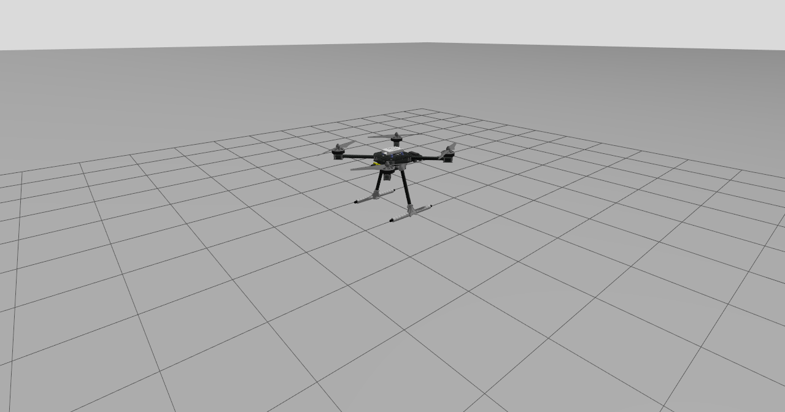
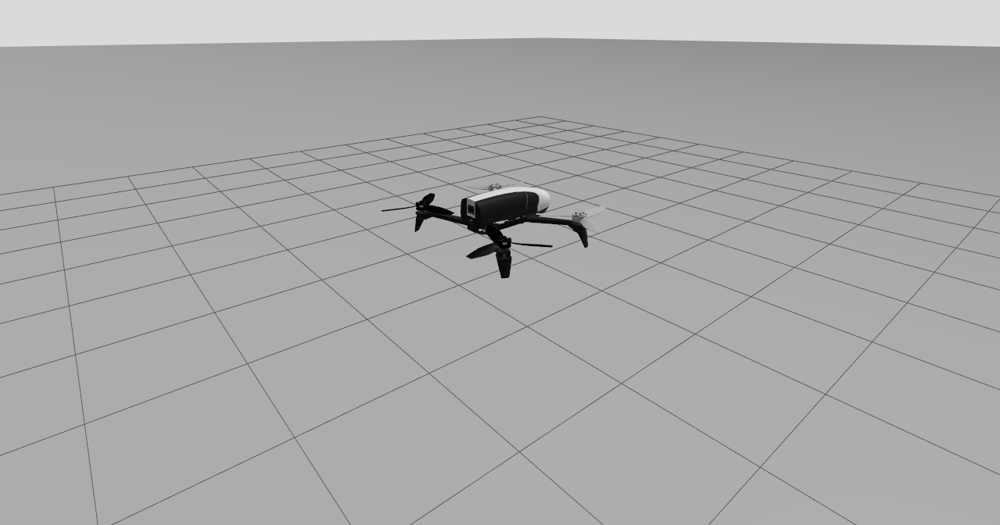
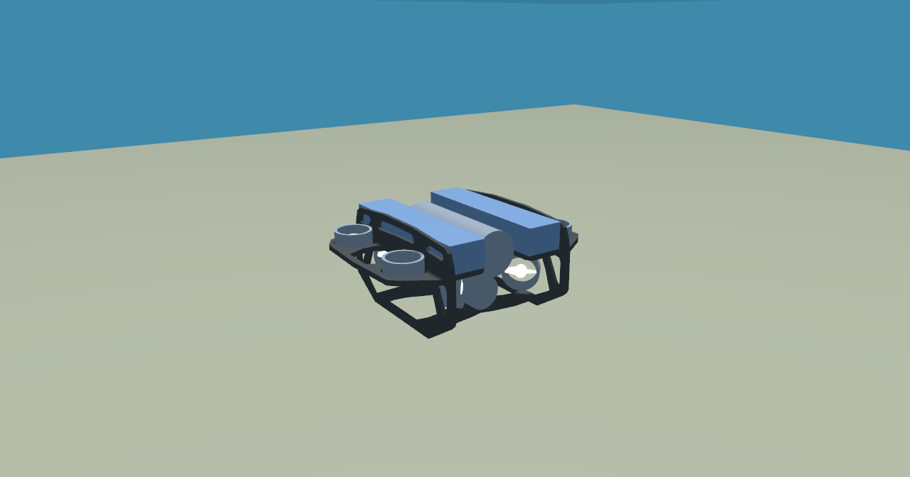

# 

[](https://github.com/juanscelyg/pilotaro/actions/workflows/rolling.yml)

Autopilot for multirotors and underwater vehicles on ROS 2. It is driven with
`std_srvs/Trigger` services and `offboard/*` setpoints, and reports its flight mode on the
`mode` topic. Main features:

- **State estimator, controller and actuator output as plugins** (pluginlib), selected and
  configured in the parameter files.
- **Real-time main loop**: `SCHED_FIFO`, locked memory and, optionally, a dedicated core.
- **Per-instance platform name** for multi-robot systems: namespace, topics, frames and
  Gazebo model all come from the same `robot_name`.
- **Vehicles described in URDF/xacro**: Holybro X500, Parrot Bebop 2 and BlueROV2 Heavy, each with
  its sensors, plus a script that updates each vehicle's parameters from its URDF.
- **Underwater world** with buoyancy and hydrodynamics (added mass, damping).

| Holybro X500 | Parrot Bebop 2 | BlueROV2 Heavy |
|:---:|:---:|:---:|
|  |  |  |
| `sim.launch.py` — LOITER at 2.2 m after takeoff | `model:=bebop2` — LOITER at 2.0 m | `robots:=rov:bluerov2_heavy` — holding depth after a 2 m dive |

## Packages

| Package | Contents |
|---|---|
| `pilotaro` | Metapackage: `launch/pilotaro.launch.py` and `params/pilotaro.params.yaml`. |
| `pilotaro_common` | ROS-free types: `RobotState`, `VehicleState`, `ControlSetpoint`, `VehicleParams`, `FlightMode`. |
| `pilotaro_core` | Plugin interfaces: `StateEstimatorBase`, `ControllerBase`, `ActuatorOutputBase`, and parameter loading. |
| `pilotaro_estimators` | `EstimatorNode` (loads the plugin, publishes the estimate) and the `OdometryEstimator` and `InsEkfEstimator` (IMU-driven EKF) plugins. |
| `pilotaro_controllers` | `ControllersNode` (loads the plugin) and the `CascadeController` (multirotors) and `UnderwaterController` (vectored thrusters) plugins. |
| `pilotaro_states` | `StatesNode`: flight modes, services, offboard setpoints. The logic lives in `FlightModeMachine` (ROS-free, with tests). |
| `pilotaro_actuators` | `ActuatorsNode` (per-mode policy, loads the plugin) and the `MotorSpeedOutput` and `ThrusterOutput` output plugins. |
| `pilotaro_system` | `PilotaroNode` (lifecycle) and `pilotaro_main`, the real-time loop. |
| `pilotaro_description` | Vehicles: `urdf/<vehicle>.urdf.xacro`, `config/<vehicle>.params.yaml`, `meshes/` (BlueROV2 Heavy) and `scripts/update_vehicle_params.py`. |
| `pilotaro_gazebo` | Empty and underwater worlds, simulation launches (one or several vehicles of any model, disaster world), `scripts/flight_check.py`, `scripts/mission_check.py` and `scripts/failsafe_check.py`. |

## Quick start

```bash
cd ~/ros_ws   # your colcon workspace, with pilotaro cloned in src/
rosdep update
rosdep install -y --ignore-src --from-paths src
colcon build --packages-up-to pilotaro pilotaro_gazebo --cmake-args -DCMAKE_BUILD_TYPE=Release
source install/setup.bash

# Gazebo (GUI) + x500 + pilotaro. headless:=true without GUI, cameras:=false without cameras
ros2 launch pilotaro_gazebo sim.launch.py

# The same with a Parrot Bebop 2
ros2 launch pilotaro_gazebo sim.launch.py model:=bebop2 robots:=bebop2

# A BlueROV2 Heavy in the underwater world (floats at the surface until armed)
ros2 launch pilotaro_gazebo sim.launch.py world:=underwater robots:=rov:bluerov2_heavy
```

Build in `Release`: without a build type colcon compiles without optimization, and the
control loop and the EKF use several times more CPU.

In another terminal (the namespace is the robot name, `x500` by default):

```bash
ros2 service call /x500/arming  std_srvs/srv/Trigger
ros2 service call /x500/takeoff std_srvs/srv/Trigger     # climbs 2 m and switches to LOITER

# offboard: first publish setpoints (>= 2 Hz), then request the mode
ros2 topic pub -r 10 /x500/offboard/pose geometry_msgs/msg/PoseStamped \
  "{header: {frame_id: odom}, pose: {position: {x: 3.0, y: 2.0, z: 3.0}, orientation: {w: 1.0}}}"
ros2 service call /x500/offboard std_srvs/srv/Trigger

ros2 service call /x500/landing std_srvs/srv/Trigger     # lands and disarms
ros2 topic echo /x500/mode
```

### Flight modes

```text
DISARMED --arming--> ARMED --takeoff--> TAKEOFF --(altitude reached)--> LOITER
ARMED --arming--> DISARMED
any but DISARMED --offboard--> OFFBOARD --(setpoint timeout)--> LOITER
flying --loiter--> LOITER          flying --landing--> LANDING --(touchdown)--> DISARMED
armed --(no state estimate for estimate_timeout)--> DISARMED
flying --(failsafe)--> LOITER, RTL, LANDING or DISARMED (see Failsafes)
ARMED --mission--> TAKEOFF --> MISSION;  flying --mission--> MISSION
MISSION --(last waypoint)--> LOITER, RTL or LANDING
flying --rtl--> RTL --(over the arming point)--> LANDING, DISARMED or LOITER
```

| Mode | Vehicle |
|---|---|
| `DISARMED` | Motors stopped. |
| `ARMED` | On the ground (or at the surface), motors at `idle_rot_velocity`. |
| `TAKEOFF` | Climbs `takeoff_altitude` from the arming point at `takeoff_speed` (dives if negative), accelerating and braking at `takeoff_acceleration`; the setpoint never leads the vehicle by more than `takeoff_max_lead`. |
| `LOITER` | Holds its position and heading. |
| `LANDING` | Descends at `landing_speed` keeping XY; disarms on touchdown. |
| `OFFBOARD` | Follows the `offboard/pose` or `offboard/twist` setpoints. |
| `MISSION` | Flies the waypoints of the `mission` topic in order (see Missions). |
| `RTL` | Returns to the arming point: climbs to `mission.rtl_altitude` over it if lower, flies back at `mission.rtl_speed` and then lands (`mission.rtl_final_action`). |

`TAKEOFF`, `LOITER`, `LANDING`, `OFFBOARD`, `MISSION` and `RTL` are the flying modes. Every service is a
`std_srvs/Trigger` in the robot namespace; a rejected command answers `success: false` with
the reason.

| Service | Accepted in | Does |
|---|---|---|
| `arming` | `DISARMED` passing the pre-arm checks, or `ARMED` | Arms (stores the arming point) or disarms. |
| `takeoff` | `ARMED`, no failsafe holding or landing the vehicle | Goes to `TAKEOFF`. |
| `loiter` | flying | Holds the current position and heading. |
| `landing` | flying | Goes to `LANDING`. |
| `offboard` | any mode but `DISARMED`, with a setpoint newer than `offboard_timeout` and no failsafe holding or landing the vehicle | Goes to `OFFBOARD`. |
| `mission` | `ARMED` (takes off first) or flying, with a mission inside the geofence and no failsafe holding or landing the vehicle | Goes to `MISSION`. |
| `rtl` | flying | Goes to `RTL`. |

| Topic | Type | |
|---|---|---|
| `mode` | `std_msgs/String` | Current mode (transient local: late subscribers get it). |
| `offboard/pose` | `geometry_msgs/PoseStamped` | Position and yaw in the world frame. With `offboard_frame_id` set, other frames are ignored. |
| `offboard/twist` | `geometry_msgs/Twist` | Linear velocity in the world frame and yaw rate (`angular.z`). |
| `estimate` | `nav_msgs/Odometry` | State estimate used by the controller: pose in the world frame, twist in the body frame (REP 147), stamp of the estimate; the horizontal uncertainty in the pose covariance. |
| `mission` | `nav_msgs/Path` | Waypoints in the world frame (position, and yaw if the orientation is set). Transient local: publish it once. Not replaced while it is being flown. |
| `mission/current` | `std_msgs/Int32` | Waypoint being flown (−1 outside a mission); transient local. |
| `battery` | `sensor_msgs/BatteryState` | Input: `percentage` (0–1) for the battery failsafes and pre-arm check. |
| `heartbeat` | `std_msgs/Empty` | Input: ground station heartbeat, if `failsafe.heartbeat_timeout` is set. |
| `failsafe` | `std_msgs/String` | Active failsafes, comma separated (empty: none); transient local. |

Offboard setpoints must keep arriving (more often than every `offboard_timeout`, 0.5 s by
default); if they stop, the vehicle holds its position in `LOITER`. Touchdown is detected
when the vehicle stays within `land_detect_altitude` of the arming point, slower than
`land_detect_speed`, for `land_detect_time`. All these parameters belong to `states_node`
in `params/pilotaro.params.yaml`.

### Failsafes

Each failsafe has a condition and an action (`failsafe.*` parameters of `states_node`):
`none`, `warn` (only reported), `loiter`, `rtl`, `land` or `disarm`. The strongest active action
is applied. While it lasts, the commands that would undo it (`takeoff`, `offboard`) are
rejected; `landing` is always accepted. The active failsafes are published on `failsafe`
and logged. The parameters can be changed in flight (`ros2 param set`).

| Failsafe | Condition | Default action |
|---|---|---|
| `battery_low` / `battery_critical` | charge ≤ `battery_low` (0.2) / `battery_critical` (0.1) | `warn` / `land` |
| `battery_lost` | battery reported once, then silent for `battery_timeout` (2 s) | `warn` |
| `geofence` | beyond `geofence_radius`, `geofence_max_height` or `geofence_max_depth` from the arming point by more than `geofence_margin` (0.3 m); all off by default | `loiter` inside the fence |
| `navigation` | horizontal uncertainty of the estimate > `max_position_std` (1 m) | `land` level, without horizontal control |
| `heartbeat` | no ground station heartbeat for `heartbeat_timeout` (off by default) | `loiter` |
| `attitude` | tilt > `max_tilt` (1.2 rad) for `max_tilt_time` (0.3 s): flip, lost motor | `disarm` |
| (state estimate lost) | no estimate for `estimate_timeout` | disarm |

- **Geofence:** offboard goals and the takeoff altitude are clamped to it, so the vehicle
  stops at the fence instead of crossing it. The failsafe only acts if it is pushed or flown
  (velocity setpoints) out.
- **Navigation lost:** `InsEkfEstimator` reports an unknown position when it has had no
  GNSS or odometry for `aiding_timeout` (5 s), as EKF2 does. Without a valid horizontal
  estimate, holding a position would chase a drifting estimate, so the vehicle descends
  level, without horizontal control (`ControlSetpoint::xy_velocity = false`), like the
  *Descend* mode of PX4. In simulation, with GNSS cut 5 s after hovering, the x500 lands
  1–3 m from where it was.
- **Underwater vehicles:** `land` takes them to the bottom. `bluerov2_heavy.params.yaml`
  uses `disarm` for battery and navigation, so the positively buoyant vehicle surfaces.

### Missions and return to launch

A mission is a list of waypoints (`nav_msgs/Path` on `mission`); the `mission` service flies
it, taking off first if the vehicle is on the ground. The setpoint travels each leg in a
straight line at `mission.speed`, accelerating and braking at `mission.acceleration`, with
the profile acceleration as feed-forward (`ControlSetpoint::acceleration`, jerk limited to
3 m/s³) and the commanded speed capped at it (`ControlSetpoint::max_speed`). It waits for a
vehicle that lags more than `mission.max_lead`, and consecutive legs share their corner, so
the path stays on the lines between waypoints. A waypoint is reached within
`mission.acceptance_radius` and below `mission.acceptance_speed`, after
`mission.hold_time`. After the last one
`mission.end_action` applies: `loiter` (default), `rtl` or `land`.

`rtl` (service, end of mission or failsafe action) climbs to `mission.rtl_altitude` over the
arming point if lower (never descends; 0 returns at the current height), flies back at
`mission.rtl_speed` and then applies `mission.rtl_final_action`: `land` (default, on the
arming point itself), `disarm` or `loiter`. The BlueROV2 Heavy returns at its depth and disarms, surfacing by its buoyancy.
A mission with a waypoint outside the geofence is rejected, and without a valid position an
`rtl` failsafe lands instead.

```bash
ros2 topic pub --once /x500/mission nav_msgs/msg/Path "{header: {frame_id: odom}, poses: [
  {pose: {position: {x: 4.0, y: 0.0, z: 3.0}}},
  {pose: {position: {x: 4.0, y: 4.0, z: 3.0}, orientation: {z: 0.707, w: 0.707}}},
  {pose: {position: {x: 0.0, y: 4.0, z: 2.0}}}]}" --qos-durability transient_local
ros2 service call /x500/arming std_srvs/srv/Trigger
ros2 service call /x500/mission std_srvs/srv/Trigger     # takes off and flies it
ros2 service call /x500/rtl std_srvs/srv/Trigger         # or return at any time
```

**Pre-arm checks** (`arming` answers with every failed check): fresh estimate; tilt below
`max_tilt_arming` (0.35 rad) and angular velocity below `max_rate_arming` (0.3 rad/s);
horizontal uncertainty below `max_position_std`; battery (if reported) fresh and above
`battery_min_arm` (0.3); ground station heartbeat (if enabled).

### Launch files

| Launch | What it does |
|---|---|
| `pilotaro pilotaro.launch.py` | pilotaro only (`robot_name`, `vehicle`, `params_file`, `vehicle_params_file`, `use_sim_time`). This is the one used on the real robot. |
| `pilotaro_gazebo spawn.launch.py` | Adds a vehicle to a running Gazebo: `robot_state_publisher`, spawn, bridge and pilotaro (`robot_name`, `model`, `world_name`, `x`, `y`, `z`, `yaw`, `cameras`, `params_file`). The bridge is generated from the sensors in the URDF. |
| `pilotaro_gazebo sim.launch.py` | Gazebo with `worlds/empty.sdf`, `/clock` bridge and one or more drones (`robots`, `model`, `spacing`, `headless`…). |
| `pilotaro_gazebo disaster.launch.py` | `disaster_nathan_benderson_park_world` world (`disaster_world` package, optional: not a declared dependency, clone it into `src/` to use this launch) with one vehicle at (-120, 950) (`model`). |

## Multi-robot: platform name

Each pilotaro instance is a process with a platform name, `robot_name`. That name is used
everywhere:

- **namespace** of the five nodes in the process: `/<robot_name>/pilotaro_node`,
  `/<robot_name>/states_node`… and therefore of all their topics and services;
- **robot name** inside pilotaro (`RobotState::get_name()`). If not given, it is taken from
  the namespace;
- in simulation, **Gazebo model name**, prefix of its topics (`/<robot_name>/imu`…),
  namespace of the motors and prefix of the frames (`<robot_name>/base_link`).

```bash
# Two drones in the same simulation
ros2 launch pilotaro_gazebo sim.launch.py robots:=uav1,uav2 spacing:=2.0

# Different models: "name:model"
ros2 launch pilotaro_gazebo sim.launch.py robots:=big:x500,small:bebop2 spacing:=3.0

# Or add one more to a running simulation
ros2 launch pilotaro_gazebo spawn.launch.py robot_name:=uav3 model:=bebop2 x:=4.0

ros2 service call /uav2/arming std_srvs/srv/Trigger
```

The parameter files use `/**/<node>:`, so they work for every robot. Each robot also loads
those of its vehicle (see [Parameters](#parameters)); if it needs its own values, pass it a
different `params_file` or `vehicle_params_file`.

## Parameters

Each instance loads two files, in this order:

1. `pilotaro/params/pilotaro.params.yaml` (`params_file`): what is common to all vehicles,
   i.e. the loop, real time, plugin selection and configuration, flight modes and actuators.
2. `pilotaro_description/config/<vehicle>.params.yaml` (`vehicle` or `vehicle_params_file`):
   the `vehicle` block (mass, inertia, rotors, motors), generated from the URDF, and the
   vehicle's own tuning. For example, the Bebop 2 changes the controller's velocity gains.
   Since it is loaded second, it can override any parameter of the first one.

## Real time

`pilotaro_main` does everything in a single thread, at `frequency` Hz (250 by default): it
collects messages and service calls and runs the estimator → states → controller → actuators
cycle. With `use_sim_time` the loop follows the simulation clock (`/clock`), so it keeps its
rate in simulated time whatever the real time factor; on a robot it follows the wall clock. Between configure and activate (plugins already loaded, before the vehicle can move)
it applies the `real_time.*` configuration:

| Parameter | Default | Effect |
|---|---|---|
| `real_time.enabled` | `true` | Enables everything below. |
| `real_time.priority` | `80` | `SCHED_FIFO` priority of the main thread (1–99). |
| `real_time.lock_memory` | `true` | `mlockall`: the process takes no page faults. |
| `real_time.cpu` | `-1` | Pins the thread to that core (`-1`: no affinity). |
| `real_time.required` | `false` | `true`: if anything fails, pilotaro does not start. `false`: warns and keeps running without real time. |

Every 10 s the node warns if any cycle took longer than the period.

### Permissions

The user needs to be allowed to request real-time priority and lock unlimited memory. On
this machine it is already set up in `/etc/security/limits.conf`:

```text
juanscelyg    -   rtprio   98
juanscelyg    -   memlock  -1
```

For another user or machine:

1. Add those two lines with the corresponding user. It can also be granted to a group
   (`@realtime - rtprio 98`, `@realtime - memlock -1`), adding the user with
   `sudo usermod -aG realtime <user>`.
2. Log out and back in. Limits are applied at login.
3. Check it:

   ```bash
   ulimit -r   # must be >= real_time.priority (98)
   ulimit -l   # must be "unlimited"
   ```

4. At startup, pilotaro confirms it in the log:

   ```text
   [pilotaro_node]: [real_time] Memory locked
   [pilotaro_node]: [real_time] SCHED_FIFO priority 80
   ```

   Without permissions it prints a `[real_time] ... failed, running without it` warning with
   the cause and the current limit (or a fatal error if `real_time.required: true`).

Notes:

- The priority must be `<= rtprio`. If the limit is lowered, `real_time.priority` must be
  lowered too.
- When launched from a systemd service, `limits.conf` does not apply; use
  `LimitRTPRIO=98` and `LimitMEMLOCK=infinity` in the unit.
- In Docker: `--cap-add=sys_nice --ulimit rtprio=98 --ulimit memlock=-1`.
- For tighter latencies, optionally: a kernel with `preempt=full` (Ubuntu 24.04's is
  `PREEMPT_DYNAMIC`, just add it to the boot command line) or a `PREEMPT_RT` kernel, and an
  isolated core (`isolcpus=3`) used with `real_time.cpu: 3`.

## Plugins

Plugins are selected and configured in `params/pilotaro.params.yaml`, and the vehicle file
can change them (the BlueROV2 Heavy changes the controller and the output). The node that loads
them reads `<plugin_name>.plugin`, and the plugin reads its parameters with the same prefix:

```yaml
/**/estimator_node:
  ros__parameters:
    estimator:
      plugin: "pilotaro_estimators/OdometryEstimator"
      topic: "odometry"
      twist_in_body_frame: true

/**/controllers_node:
  ros__parameters:
    controller:
      plugin: "pilotaro_controllers/CascadeController"
      position_p: [1.0, 1.0, 1.5]
      # ...

/**/actuators_node:
  ros__parameters:
    output:
      plugin: "pilotaro_actuators/MotorSpeedOutput"
      topic: "command/motor_speed"
```

| Node | Interface | Plugins |
|---|---|---|
| `estimator_node` | `pilotaro::StateEstimatorBase` | `pilotaro_estimators/OdometryEstimator`, `pilotaro_estimators/InsEkfEstimator` |
| `controllers_node` | `pilotaro::ControllerBase` | `pilotaro_controllers/CascadeController`, `pilotaro_controllers/UnderwaterController` |
| `actuators_node` | `pilotaro::ActuatorOutputBase` | `pilotaro_actuators/MotorSpeedOutput`, `pilotaro_actuators/ThrusterOutput` |

### Estimator: `pilotaro_estimators/OdometryEstimator`

Takes the state from a `nav_msgs/Odometry` (in simulation, the *ground truth* odometry of
the `OdometryPublisher` at 250 Hz):

| Parameter | Default | |
|---|---|---|
| `topic` | `odometry` | Relative to the robot namespace. |
| `twist_in_body_frame` | `true` | Twist in the child frame (REP 147). `false`: linear velocity in world. |
| `frame_id` | `""` | If set, odometry with a different `header.frame_id` is ignored. |
| `use_message_stamp` | `true` | `false`: stamps the estimate with the reception time. |

The rest of the system runs at the pace of the estimates: the controller only runs on a new
estimate, and its `dt` is the difference between their stamps. If no estimates arrive for
`estimate_timeout` while the vehicle is armed, it disarms.

### Estimator: `pilotaro_estimators/InsEkfEstimator`

Inertial navigation with the vehicle's own sensors: an error-state EKF (16 states: position,
velocity, attitude, accelerometer and gyro biases, barometer offset) that integrates the IMU
and corrects it with GNSS, barometer, magnetometer and, optionally, an external odometry
(VIO, DVL + USBL, motion capture...). It gives an estimate on every IMU sample.

- **Start:** once the vehicle has been still for `init_time`. Roll and pitch come from the
  accelerometer, the gyro bias from the mean gyro, the yaw from the magnetometer (or the
  odometry), the position from the first GNSS fix (or the odometry).
- **Magnetometer:** the direction of the field is fused in 3D (body = Rᵀ·world), which
  keeps tilt and heading consistent; only its horizontal direction (`mag_heading`) has to
  be given, its inclination is measured at the start.
- **Outliers and recovery:** measurements beyond `innovation_gate` sigmas are rejected. If a
  sensor keeps being rejected for `reset_timeout`, its state (position, velocity or
  barometer offset) is reset to it, as EKF2 does. This recovers, for instance, from a
  touchdown the IMU did not sample.
- **Cost:** about 0.2 % of a core at 250 Hz (Release build).

| Parameter | Default | |
|---|---|---|
| `imu_topic`, `gnss_topic`, `baro_topic`, `mag_topic` | `imu`, `navsat`, `air_pressure`, `magnetometer` | Empty disables the sensor (except the IMU). |
| `gnss_velocity_topic`, `odometry_topic` | `""` | GNSS velocity (`TwistWithCovarianceStamped`, ENU) and external odometry. |
| `gnss_origin` | `[]` | `[lat, lon, alt]` of the world origin; empty: the first fix. |
| `gnss_noise`, `gnss_velocity_noise` | `[0.5, 1.0]` m, `0.1` m/s | Horizontal and vertical. |
| `baro_noise`, `sea_level_pressure` | `0.5` m, `101325` Pa | |
| `mag_heading`, `mag_noise` | `0` rad, `0.05` | Direction of the horizontal field from world x (π/2 − declination in ENU); noise of the unit field vector. |
| `odometry_position_noise`, `odometry_velocity_noise`, `odometry_attitude_noise`, `odometry_yaw_noise` | `0.05` m, `0`, `0`, `0` | 0 = not fused. |
| `gyro_noise`, `accel_noise` | `1e-3`, `4e-3` | Process noise densities (rad/s/√Hz, m/s²/√Hz). |
| `gyro_bias_noise`, `accel_bias_noise`, `baro_bias_noise` | `1e-5`, `1e-4`, `5e-3` | Random walk of the biases. |
| `innovation_gate`, `reset_timeout`, `init_time` | `5` σ, `1` s, `1` s | |

```yaml
/**/estimator_node:
  ros__parameters:
    estimator:
      plugin: "pilotaro_estimators/InsEkfEstimator"
      gnss_origin: [40.2849, -3.8211, 650.0]   # spherical_coordinates of the world
      mag_heading: 0.0448                      # horizontal field of the gz world, from x
```

### Controller: `pilotaro_controllers/CascadeController`

Cascade controller for multirotors: position P → velocity PI → thrust → SO(3) attitude
PD → allocation. Allocation uses the pseudoinverse, so it supports any planar geometry with 4 or
more rotors (there is a test with a hexarotor). Its gains and limits are in the `controller`
block. It only accepts rotors that push towards +z and are not reversible.

- **Yaw within the rotor authority:** the yaw error commands a yaw rate limited to
  `max_yaw_rate` (1 rad/s, 0 = no limit); while not limited it is the same PD law.
- **Desaturation by priorities:** when the rotors cannot give the whole wrench, roll and
  pitch come first (the collective thrust moves to make them fit, and they are scaled down
  only if the difference between rotors does not fit), then as much yaw torque as fits in
  the remaining margin. A large yaw step no longer takes thrust or attitude away: on the
  x500, the time with saturated motors in a 90° yaw went from 0.37 s to 0.10 s.

Both controllers share two features:

- **Filtered measurements:** first-order low-pass filters on the measured velocity
  (`velocity_cutoff`, 10 Hz) and angular velocity (`angular_rate_cutoff`, 10 Hz), and
  optionally on the position (`position_cutoff`, 0 = off). Estimation noise would otherwise
  reach the actuators: with estimator-like noise they cut the motor activity by two thirds.
  At 5 Hz the velocity filter delayed the settling (±5 cm in 3.0 s instead of 2.2 s).
- **Straight-line approach:** with a position setpoint on the 3 axes, the velocity setpoint
  points at the goal and the whole vector is scaled down to the speed limits (and to
  `ControlSetpoint::max_speed`, used by missions), so the vehicle moves along the straight
  line to it. Within 1 m of the goal the gain blends back into the gain of each axis, so
  every axis converges at its own rate.

### Controller: `pilotaro_controllers/UnderwaterController`

For vehicles with vectored, reversible thrusters (ROV, AUV). Controls 6 DOF:

- **Position and velocity:** position P and velocity PI in the world frame.
- **Force:** computed with the mass plus added mass, with feed-forward of linear and
  quadratic damping at the setpoint velocity and of the net buoyancy.
- **Attitude:** roll and pitch to zero and the setpoint yaw, with an SO(3) PD that uses the
  inertia plus added inertia.
- **Allocation:** the wrench is distributed among the thrusters with the pseudoinverse of the
  thruster matrix (position, axis and reaction torque of each one).
- **Uncontrollable DOF:** selected automatically, by priority (surge, sway, heave, yaw, roll,
  pitch). The 8 thrusters of the BlueROV2 Heavy actuate all 6 DOF; on a vehicle where one
  is not actuated (e.g. pitch on a 6-thruster BlueROV2) it is left to its hydrostatic
  stability and the log says so (`not actuated: pitch`).
- **Saturation:** if a thruster saturates, all of them are scaled together to keep the
  direction of the wrench.

Parameters (prefix `controller.`): `position_p`, `velocity_p`, `velocity_i`,
`velocity_i_max`, `attitude_p`, `angular_rate_p`, `max_horizontal_speed`,
`max_vertical_speed`, `added_mass`, `added_inertia`, `linear_damping`, `quadratic_damping`,
`net_buoyancy`, `position_cutoff`, `velocity_cutoff` and `angular_rate_cutoff`.

The gains in the main file are the multirotor ones, and both controllers share names
(`position_p`, `velocity_p`…). So when a vehicle file switches controller, it must set all
of its parameters, as `config/bluerov2_heavy.params.yaml` does.

### Actuator output

`ActuatorsNode` decides the speed of each rotor every cycle: 0 in DISARMED,
`idle_rot_velocity` in ARMED and the controller output in flight. The plugin sends it:

- **`MotorSpeedOutput`:** one `actuator_msgs/Actuators` with all speeds (`topic` parameter).
  This is the format of Gazebo's `MulticopterMotorModel`.
- **`ThrusterOutput`:** one `std_msgs/Float64` per thruster, on `topic_pattern`
  (`thruster_{}/cmd_thrust`). With `command: thrust` it sends the thrust in N
  (`motor_constant·w·|w|`); with `angular_velocity`, the speed. This is the format of
  Gazebo's `Thruster` system.

### Writing a new plugin

An estimator derives from `pilotaro::StateEstimatorBase`; a controller, from
`pilotaro::ControllerBase`. For example, an estimator fusing IMU and GPS:

```cpp
#include "pilotaro_core/StateEstimatorBase.hpp"

namespace my_estimators
{
class ImuGpsEstimator : public pilotaro::StateEstimatorBase
{
public:
  // Called every cycle. true if `estimate` holds a new estimate
  bool update(pilotaro::VehicleState & estimate) override;
  void reset() override;

protected:
  // Read parameters (prefixed with "estimator.") and create subscriptions
  bool on_initialize() override
  {
    gps_noise_ = declare_parameter("gps_noise", 0.5);
    imu_sub_ = get_node()->create_subscription<sensor_msgs::msg::Imu>(
      declare_parameter<std::string>("imu_topic", "imu"), rclcpp::SensorDataQoS(), ...);
    // get_vehicle(): mass, inertia, rotors...
    return true;
  }
};
}  // namespace my_estimators

#include "pluginlib/class_list_macros.hpp"
PLUGINLIB_EXPORT_CLASS(my_estimators::ImuGpsEstimator, pilotaro::StateEstimatorBase)
```

```xml
<!-- my_estimators_plugins.xml -->
<library path="my_estimators">
  <class name="my_estimators/ImuGpsEstimator" type="my_estimators::ImuGpsEstimator"
         base_class_type="pilotaro::StateEstimatorBase">
    <description>EKF with IMU and GPS</description>
  </class>
</library>
```

```cmake
pluginlib_export_plugin_description_file(pilotaro_core my_estimators_plugins.xml)
```

Then just set `estimator.plugin: "my_estimators/ImuGpsEstimator"` in the parameter file.
Callbacks and `update()` run on the real-time thread: avoid blocking calls and memory
allocations inside `update()`.

## Vehicles

Each vehicle in `pilotaro_description` has its URDF in `urdf/<vehicle>.urdf.xacro`, built
with the macros in [`urdf/common.xacro`](pilotaro_description/urdf/common.xacro) (rotor with
its `MulticopterMotorModel`, marine thruster with its `Thruster`, hydrodynamics, IMU,
barometer, magnetometer, GPS, camera, rangefinder and odometry), and its parameters in
`config/<vehicle>.params.yaml`. All topics are prefixed with the robot name.

| | x500 | bebop2 | bluerov2_heavy |
|---|---|---|---|
| Model | Holybro X500 (PX4) | Parrot Bebop 2 | Blue Robotics BlueROV2 Heavy (8 thrusters, PX4 model) |
| Mass | 2.114 kg | 0.503 kg | 13.4 kg, buoyancy +0.98 N |
| Actuators (order) | 0 FR ccw, 1 RL ccw, 2 FL cw, 3 RR cw (PX4) | 0 FR ccw, 1 FL cw, 2 RL ccw, 3 RR cw (Parrot) | 4 horizontal at 45° (0 FR, 1 FL, 2 RR, 3 RL) and 4 vertical at the corners (4 FR up, 5 FL down, 6 RR down, 7 RL up) (PX4) |
| `motor_constant` | 8.55e-6 N/(rad/s)² | 1.90e-6 N/(rad/s)² | 0.002 N/(rad/s)², ±49.7 N |
| Hover / max | 778 / 1000 rad/s (T/W 1.65) | 805 / 1250 rad/s (T/W 2.4) | reversible, ±158 rad/s |
| Controller / output | Cascade / MotorSpeed | Cascade / MotorSpeed | Underwater / Thruster |
| IMU, magnetometer | 250, 50 Hz; IMU noise of the PX4 x500 model | 250, 50 Hz | 250, 50 Hz; IMU noise of the PX4 BlueROV2 Heavy model |
| Barometer, GPS | 50, 10 Hz | 50, 10 Hz | |
| Front camera `camera_front` | 1280×960, 97°, 30 Hz | 1280×720, 80°, 30 Hz | 1280×720, 80°, 30 Hz |
| Downward camera `camera_down` | 640×360, 86°, 30 Hz | 320×240 (optical flow), 64°, 30 Hz | |
| Range to ground `sonar` (`LaserScan`) | | ultrasound, 0.25–8 m, 30 Hz | Ping echosounder, 0.3–30 m, 10 Hz |
| Thrusters (input) | | | `thruster_<i>/cmd_thrust` (`Float64`, N) |
| Spawn | at rest, 0.24 m | at rest, 0.065 m | at the surface, z = 0 |

(FR: front right, FL: front left, RL: rear left, RR: rear right.)

Data sources:

- **x500:** PX4 model on Fuel (geometry, masses, motors and meshes, CC-BY 4.0).
- **bebop2:** mass, inertia tensor, propeller positions and meshes from Open Robotics'
  "Parrot Bebop 2" model on Fuel (CC0). Rotor thrust, torque and drag coefficients from the
  aerodynamic model identified in flight by S. Sun et al. (TU Delft, 2019,
  [bebop2_aerodynamic_model](https://bitbucket.org/SihaoSun/bebop2_aerodynamic_model)).
  Parrot rotor order and spin directions, as in BebopS. Details are in the header of
  [`bebop2.urdf.xacro`](pilotaro_description/urdf/bebop2.urdf.xacro).
- **bluerov2_heavy:** the same vehicle as PX4's `uuv_bluerov2_heavy` model
  ([PX4-gazebo-models](https://github.com/PX4/PX4-gazebo-models), BSD 3-Clause; airframe
  `60002_gz_uuv_bluerov2_heavy`), so that pilotaro and PX4 can be compared on one platform:
  - Rigid body: 13 kg hull with inertia (0.250, 0.221, 0.356) kg·m² plus 8 thrusters of
    0.05 kg. The thruster links here weigh 2 g, so the hull is set for the same totals:
    13.4 kg and (0.263, 0.229, 0.375) kg·m² about the center of mass.
  - Thruster positions, orientations and spin directions of the PX4 model.
  - Added mass, linear and quadratic damping of the PX4 model.
  - Buoyancy: its 0.50 × 0.25 × 0.108 m box, 2 cm above `base_link`: +0.98 N net.
  - Thrust limit: the PX4 thrust polynomials give +66.5 / −49.7 N at full command; the URDF
    limits both directions to 49.7 N, so the allocation stays symmetric.
  - Visual: the PX4 meshes, in
    [`meshes/bluerov2_heavy`](pilotaro_description/meshes/bluerov2_heavy/README.md), which
    keep their BSD 3-Clause license; the rest of pilotaro stays Apache 2.0.

The x500 and Bebop 2 meshes are downloaded from Fuel the first time (an internet connection
is needed); the BlueROV2 Heavy meshes are installed with `pilotaro_description`. With
`cameras:=false` the models have no cameras, which makes multi-drone simulations much
lighter.

### Underwater vehicles and the `underwater` world

[`worlds/underwater.sdf`](pilotaro_gazebo/worlds/underwater.sdf) has water (1000 kg/m³)
below z = 0 and air above, with the `Buoyancy` system in `graded_buoyancy` mode: a partially
submerged body gets the buoyancy of its submerged part, so a vehicle with positive buoyancy
really floats at the surface. The sandy bottom is at 10 m, with a pipeline and two rocks to
look at with the camera and the echosounder.

In the URDF, each underwater vehicle has:

- **Buoyancy:** the volume of its `base_link` collisions times the water density. On the
  BlueROV2 Heavy, the box gives the weight plus 0.98 N, with its center 2 cm above the
  center of mass, which stabilizes roll and pitch.
- **Hydrodynamics:** `Hydrodynamics` system with linear and quadratic damping,
  `pilotaro_hydrodynamics` macro.
- **Added mass:** the plugin's explicit computation is unstable when it exceeds the link
  mass, as it does in sway and heave on light ROV hulls. So it is
  disabled in the plugin (`disable_added_mass`) and `spawn.launch.py` passes it to the
  link's `<fluid_added_mass>` when generating the SDF. There DART integrates it implicitly
  and stably.
- **Thrusters:** `Thruster` system in thrust mode, `pilotaro_thruster` macro.

For an underwater vehicle:

- **"Takeoff"** with negative `takeoff_altitude`: dives that depth from the arming point
  (2 m on the BlueROV2 Heavy).
- **"Landing":** descends at `landing_speed` until it rests on the bottom, then disarms.
- **Surfacing:** with offboard or, with positive buoyancy, by disarming.

### Parameters from the URDF

The URDF is the single source of truth for the vehicle. If it changes (mass, arms, motors,
sensors), the `vehicle` block of its parameter file must be regenerated. There is one test
per vehicle (`colcon test --packages-select pilotaro_description`) that fails if they do not
match.

```bash
# From src/pilotaro/pilotaro_description/scripts
./update_vehicle_params.py                    # x500: urdf/x500.urdf.xacro -> config/x500.params.yaml
./update_vehicle_params.py --vehicle bebop2   # bebop2
./update_vehicle_params.py --dry-run          # only prints the block
./update_vehicle_params.py --check            # exits with 1 if the file does not match the URDF
./update_vehicle_params.py --xacro-arg cameras:=false

# From anywhere, with explicit paths
ros2 run pilotaro_description update_vehicle_params.py \
  --urdf src/pilotaro/pilotaro_description/urdf/x500.urdf.xacro \
  --params src/pilotaro/pilotaro_description/config/x500.params.yaml
```

The script computes, using all the links in the URDF:

- **mass:** the sum over all links;
- **center of mass:** that of the whole vehicle;
- **inertia:** the diagonal of the inertia tensor about the center of mass, using Steiner;
- **rotor positions:** relative to the center of mass.

Motor constants and spin directions are read from the `MulticopterMotorModel` plugins. It
only changes the lines of the `vehicle` block and keeps `gravity` and `min_rot_velocity`,
which are not in the URDF.

No vehicle is symmetric about its center of mass:

- **x500:** the cameras move the center of mass 2 mm forward, so the `rotor_x` values are
  0.1719 / -0.1761.
- **Bebop 2:** the front propellers are at 0.085 m and the rear ones at 0.090 m.

In both cases the front rotors carry slightly more thrust in hover. The controller's
allocation accounts for it.

### Adding a vehicle

1. Write `urdf/<vehicle>.urdf.xacro` with the macros in `common.xacro`: one
   `pilotaro_rotor` per motor (multirotor) or one `pilotaro_thruster` per thruster, with
   `pilotaro_hydrodynamics` (underwater), and whatever sensors it has. See
   `bebop2.urdf.xacro` and `bluerov2_heavy.urdf.xacro` as examples.
2. Generate its parameters: `./update_vehicle_params.py --vehicle <vehicle>`. The file is
   created if it does not exist.
3. Add its resting height to `SPAWN_HEIGHT` in `pilotaro_gazebo/launch/spawn.launch.py` and
   the vehicle to the test list in `pilotaro_description/CMakeLists.txt`.
4. Test it with `flight_check.py` (see [Tests](#tests)) and, if needed, tune the controller
   in `config/<vehicle>.params.yaml`.

## Tests

- **Unit tests:**

  ```bash
  colcon test --packages-select pilotaro_common pilotaro_estimators pilotaro_controllers \
    pilotaro_states pilotaro_actuators pilotaro_description
  ```

  They cover:
  - types and estimators: the INS EKF following a flight with biased, noisy sensors,
    learning the biases at rest, rejecting outliers and recovering from a state the GNSS
    keeps contradicting, the 3D magnetometer and orientation updates, and its start-up;
  - both controllers: the multirotor one with the Bebop 2 parameters and a hexarotor; the
    underwater one with the BlueROV2 Heavy (all 6 DOF) and a 6-thruster BlueROV2 (pitch not
    actuated) geometry, checking the actuated DOF, buoyancy feed-forward, rotation to the
    body frame and saturation; the multirotor desaturation (thrust and roll kept under an
    excessive yaw torque) and the yaw rate limit;
  - the measurement filters and the straight-line velocity setpoint (`test_shaping`);
  - the mode state machine, including diving and the takeoff profile (acceleration, braking
    and no lead over a vehicle still on the ground), the pre-arm checks and every failsafe
    (battery, geofence and depth limit, navigation, ground station link, flip), missions
    (from the ground, straight legs at the mission speed, geofence) and return to launch;
  - the output plugins;
  - URDF ↔ parameters consistency for each vehicle.
- **Flight test** ([`flight_check.py`](pilotaro_gazebo/scripts/flight_check.py)): flies all
  the given robots at once and checks each step against a criterion:
  1. takeoff is rejected if not armed;
  2. arms, takes off and reaches LOITER at the takeoff altitude;
  3. holds position in hover without saturating the motors;
  4. in offboard, reaches a 3D goal (measuring overshoot) and a yaw change;
  5. lands and disarms.

  For underwater vehicles there are two optional physical checks:
  - `--expect-float Z`: disarmed, it floats still at the surface at z = Z. The check first
    waits (up to `--settle-time`, 60 s) until the vehicle stops bobbing after the spawn;
  - `--expect-ascent V`: after disarming on the bottom, it rises on its own at the terminal
    velocity V given by its net buoyancy and damping.

  Exits with 0 if everything passes.

  ```bash
  ros2 launch pilotaro_gazebo sim.launch.py headless:=true cameras:=false \
    robots:=big:x500,small:bebop2 spacing:=3.0
  ros2 run pilotaro_gazebo flight_check.py big small
  ```

  Simulation results, with both flying at the same time:

  | | x500 | bebop2 |
  |---|---|---|
  | Altitude after takeoff | 2.229 m (target 2.227) | 2.044 m (target 2.051) |
  | Hover drift (5 s) | 2.1 cm | 0.5 cm |
  | Rotors in hover | 769 rad/s | 819 / 818 / 792 / 793 rad/s |
  | Offboard goal (2, 1, 1) m: error / overshoot | 0.6 cm / 1.4 cm | 3.2 cm / 7.0 cm |
  | Yaw 90° | 0.0° | 0.0° |
  | Landing | DISARMED | DISARMED |

  BlueROV2 Heavy in the underwater world:

  ```bash
  ros2 launch pilotaro_gazebo sim.launch.py headless:=true world:=underwater robots:=rov1:bluerov2_heavy
  ros2 run pilotaro_gazebo flight_check.py rov1 --takeoff-altitude -2.0 --goal-time 15 \
    --landing-time 80 --max-rotor-speed 157.7 --expect-float -0.0732 --expect-ascent 0.0412
  ```

  Expected values, computed by hand:
  - **floating:** z = −0.0732 m, the submerged volume (13.4 dm³ of the 13.5 dm³ box) that
    balances the weight;
  - **passive ascent:** 19.0·w² + 23.0·w = 0.98 N gives w = 0.0412 m/s.

  | | bluerov2_heavy |
  |---|---|
  | Floating, disarmed | z = −0.073 m (expected −0.073), still |
  | Dive to 2 m | z = −2.067 m (target −2.073) |
  | Depth-hold drift (5 s) | 0.4 cm |
  | Offboard goal (2, 1, 1) m: error / overshoot | 0.2 cm / 0.0 cm |
  | Yaw 90° | 0.0° |
  | Descent to the bottom | DISARMED at z = −9.97 m |
  | Passive ascent | 0.041 m/s (expected 0.041) |

- **Mission test** ([`mission_check.py`](pilotaro_gazebo/scripts/mission_check.py)): from
  the ground, an x500 flies three waypoints and returns to launch (`mission.end_action`
  `rtl`). Measured with the ground truth: closest approach 6–11 cm to each waypoint,
  cross-track error up to 0.22 m on its short 4 m legs, top speed 2.16 m/s for a mission
  speed of 2 m/s, climb to the return height and touchdown on the arming point (0.00 m).
  On a 10 m square, the same mission flown by PX4 1.17 passes 13–26 cm from the waypoints
  and takes 28 s, against 3–4 cm and 21 s for pilotaro.

  ```bash
  ros2 launch pilotaro_gazebo sim.launch.py headless:=true robots:=uav1:x500
  ros2 run pilotaro_gazebo mission_check.py uav1     # 14/14 checks passed
  ```

- **Failsafe test** ([`failsafe_check.py`](pilotaro_gazebo/scripts/failsafe_check.py)):
  injects failures into one robot, setting the failsafe parameters at run time: arming
  rejected with a low battery; an offboard goal beyond a 3 m geofence stops at the fence;
  when the ground station heartbeats stop the vehicle loiters, rejects offboard and reports
  the failsafe, which clears when they come back; with a critical battery it lands and
  disarms, rejecting takeoff and offboard meanwhile.

  ```bash
  ros2 launch pilotaro_gazebo sim.launch.py headless:=true robots:=uav1:x500
  ros2 run pilotaro_gazebo failsafe_check.py uav1     # 13/13 checks passed
  ```

### Continuous integration

[`.github/workflows/rolling.yml`](.github/workflows/rolling.yml) checks that pilotaro works on
ROS 2 Rolling. It runs on every push and pull request to `rolling`, every Monday (Rolling
changes daily) and on demand (*Actions → rolling → Run workflow*). In a `ros:rolling`
container, without a GPU, it:

1. installs the dependencies with `rosdep`;
2. builds every package;
3. runs the unit tests (`colcon test` + `colcon test-result --verbose`);
4. flies the x500 and the Bebop 2 together in the `empty` world with `flight_check.py`
   (Gazebo headless, `cameras:=false`);
5. flies the BlueROV2 Heavy in the `underwater` world (it needs water to float) with
   `flight_check.py`, including the floating and passive ascent checks;
6. flies a waypoint mission with an x500 and returns to launch with `mission_check.py`;
7. injects failures into an x500 with `failsafe_check.py`.

Each simulation step uses its own Gazebo partition and ROS domain and removes any Gazebo
server left at the end, so a step cannot interfere with the next one. Any failed check
fails the run, and the colcon and simulation logs are uploaded as the `logs` artifact. The same steps can be reproduced locally:

```bash
docker run --rm -it -v $PWD:/ws/src/pilotaro -w /ws ros:rolling bash
# inside the container, the "run" blocks of rolling.yml in order, e.g.:
apt-get update && rosdep update
rosdep install -y --ignore-src --from-paths src
source /opt/ros/rolling/setup.bash && colcon build --cmake-args -DCMAKE_BUILD_TYPE=Release
```

## License

pilotaro is licensed under the [Apache License 2.0](LICENSE), Copyright 2026 Juan S. Cely G.
Every source, launch, URDF/xacro, world, parameter and build file carries that header.

Third-party content keeps its own license:

| Component | Where | Source | License |
|---|---|---|---|
| BlueROV2 Heavy meshes | [`pilotaro_description/meshes/bluerov2_heavy`](pilotaro_description/meshes/bluerov2_heavy/README.md) (distributed, unmodified) | [PX4-gazebo-models](https://github.com/PX4/PX4-gazebo-models) `uuv_bluerov2_heavy`, N. De Carli (KTH), PX4 Autopilot | BSD 3-Clause ([`LICENSE`](pilotaro_description/meshes/bluerov2_heavy/LICENSE)) |
| x500 meshes | Downloaded from Fuel at run time, not distributed | [PX4 x500](https://app.gazebosim.org/PX4/fuel/models/x500), Benjamin Perseghetti | CC-BY 4.0 |
| Bebop 2 meshes | Downloaded from Fuel at run time, not distributed | [Parrot Bebop 2](https://app.gazebosim.org/OpenRobotics/fuel/models/Parrot%20Bebop%202), Open Robotics | CC0 |
| Simulation screenshots | [`docs/images`](docs/images) | Gazebo renders of pilotaro | Apache 2.0; each vehicle shown keeps the license of its mesh (rows above) |

Physical parameters taken from other works (masses, inertias, thruster geometry, rotor and
hydrodynamic coefficients) are cited where they are used, in the header of each
`urdf/<vehicle>.urdf.xacro` and in [Vehicles](#vehicles): the PX4 x500 model (CC-BY 4.0),
the Parrot Bebop 2 model of Open Robotics (CC0), S. Sun et al. (TU Delft, 2019) and the PX4
`uuv_bluerov2_heavy` model (PX4-gazebo-models, BSD 3-Clause).
